<p align="center">
  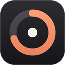
</p>

<h1 align="center">LimitGadget</h1>

<p align="center">
  Os limites de uso das suas IAs, sempre à vista na barra de tarefas do Windows.<br>
  Claude, ChatGPT/Codex, GitHub Copilot e Antigravity em um só lugar.
</p>

<p align="center">
  <a href="https://github.com/brunocsilva41/limit-gadget/actions/workflows/ci.yml"></a>
  <a href="https://github.com/brunocsilva41/limit-gadget/releases/latest"></a>
  
  <a href="LICENSE"></a>
</p>

<p align="center">
  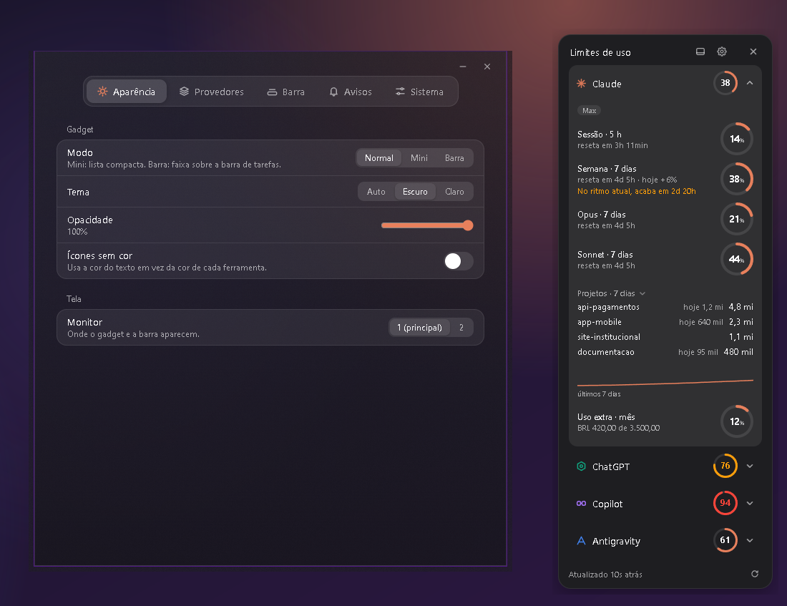
</p>

<p align="center"><sub>Capturas com dados de exemplo.</sub></p>

## Por que usar

Cada ferramenta de IA tem o seu próprio limite (por sessão, por semana, por mês) e cada uma o mostra num lugar diferente. O LimitGadget junta tudo numa leitura rápida: um **anel de porcentagem** por provedor, o tempo até o limite renovar e um aviso antes de você ser pego de surpresa.

- **Quatro provedores:** Claude, ChatGPT/Codex, GitHub Copilot e Antigravity.
- **Três formas de exibir:** barra sobre a barra de tarefas, lista Mini flutuante ou painel Normal com detalhes.
- **Anéis de porcentagem** que ficam âmbar e vermelhos conforme o limite se aproxima.
- **Previsão de esgotamento:** "no ritmo atual, acaba em 2d 20h".
- **Uso por projeto** no Claude Code e **últimas sessões dos 7 dias** no ChatGPT/Codex e no Copilot.
- **Avisos** ao passar dos níveis de atenção e crítico, quando o limite renova, meta de consumo por dia e resumo semanal.
- **Atalho global** `Ctrl+Alt+L` para mostrar ou ocultar.
- **Leve e privado:** sem telemetria, nenhum dado sai do seu computador, fora as consultas de cada provedor à própria API dele.

## Como fica

### Barra na barra de tarefas

Uma faixa que encosta na bandeja do Windows, com a cor real da barra de tarefas. Dá para soltar o pino e arrastá-la pela barra, ou usar a versão compacta, com setas para alternar entre os provedores.

<p align="center">
  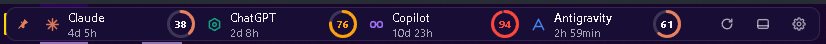
</p>

### Mini e Normal

<table>
  <tr>
    <td align="center" valign="top">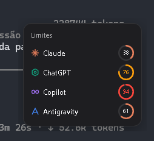<br><sub>Mini: uma lista discreta</sub></td>
    <td align="center" valign="top">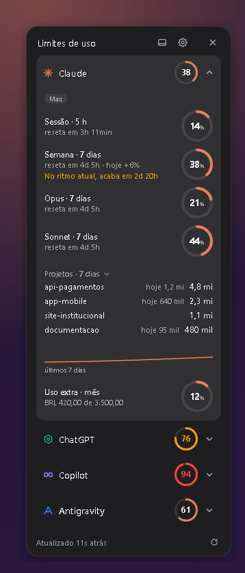<br><sub>Normal: limites, projetos e histórico</sub></td>
  </tr>
</table>

### Sessões recentes e consumo

Cada provedor abre com os seus detalhes. As seções de projetos e de sessões podem ser recolhidas.

<table>
  <tr>
    <td align="center" valign="top">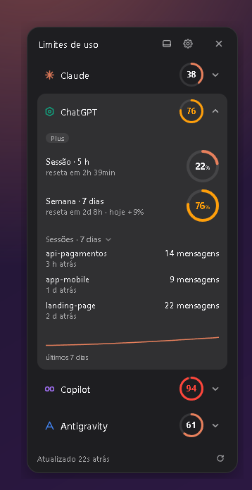<br><sub>ChatGPT/Codex</sub></td>
    <td align="center" valign="top">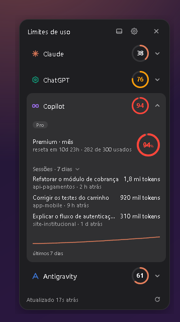<br><sub>GitHub Copilot</sub></td>
  </tr>
</table>

### Configurações

Janela translúcida com abas por categoria.

<table>
  <tr>
    <td align="center">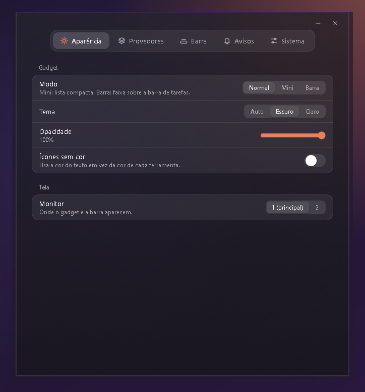<br><sub>Aparência</sub></td>
    <td align="center">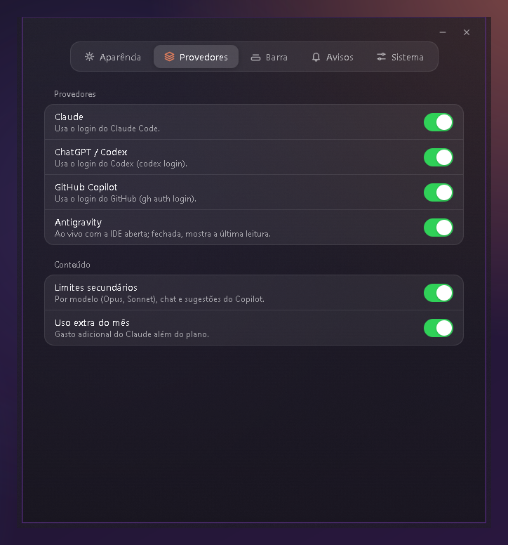<br><sub>Provedores</sub></td>
    <td align="center">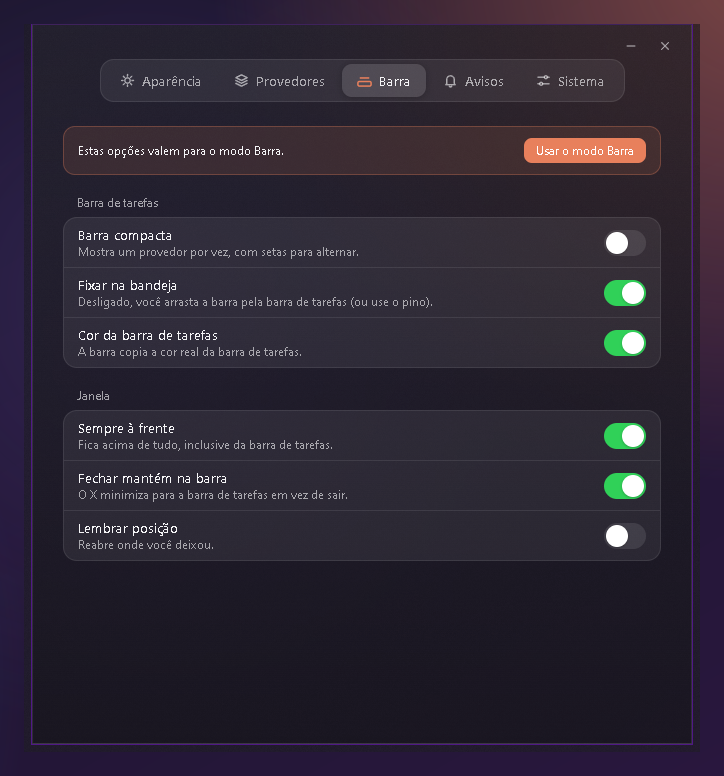<br><sub>Barra</sub></td>
  </tr>
  <tr>
    <td align="center">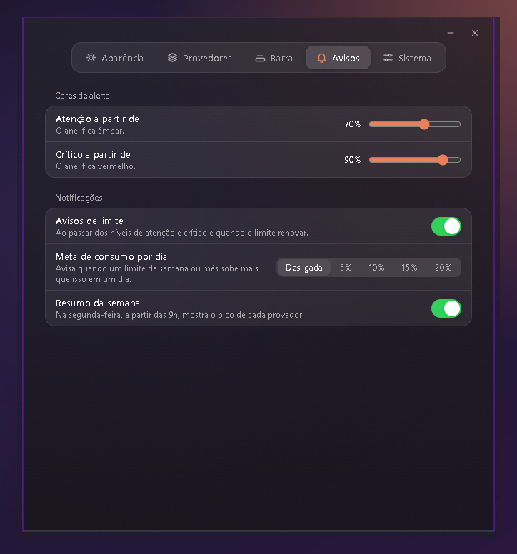<br><sub>Avisos</sub></td>
    <td align="center">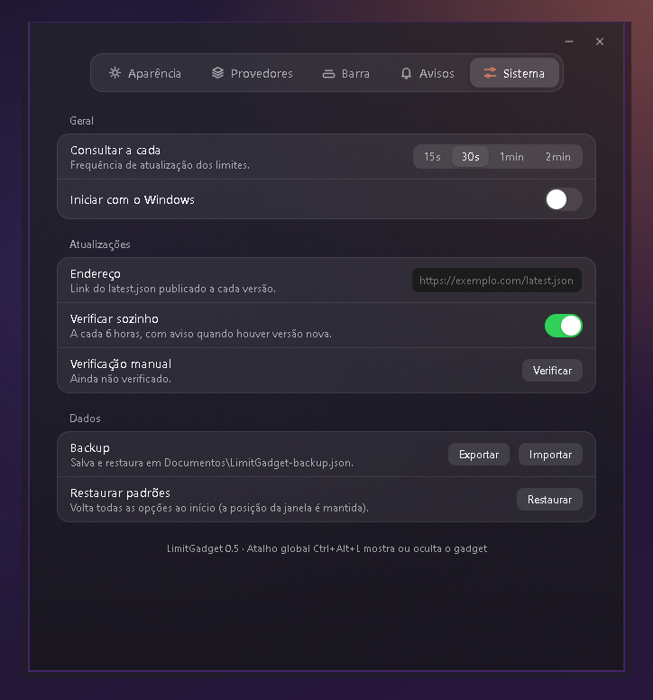<br><sub>Sistema</sub></td>
    <td></td>
  </tr>
</table>

## Instalação

1. Baixe o instalador `LimitGadget_<versão>_x64-setup.exe` na [última release](https://github.com/brunocsilva41/limit-gadget/releases/latest).
2. Execute-o. A instalação é só para o seu usuário e não pede administrador.
3. Abra o LimitGadget. Ele aparece na bandeja e, no modo Barra, ao lado dela.

> **Aviso do Windows:** o instalador ainda não tem certificado de assinatura de código, então o SmartScreen pode mostrar "O Windows protegeu o seu PC". Clique em **Mais informações** e depois em **Executar assim mesmo**. O instalador é gerado pela pipeline deste repositório, e o código está aberto para conferência.

**Requisitos:** Windows 10 ou 11 (x64) e o WebView2 Runtime, que já vem no Windows moderno.

### De onde vêm os dados

O LimitGadget usa o login que você já tem em cada ferramenta. Não pede senha nem token.

| Provedor | Precisa de | O que mostra |
| --- | --- | --- |
| Claude | Estar logado no Claude Code | Sessão de 5 h, semana, modelos e uso extra |
| ChatGPT/Codex | Estar logado no Codex (`codex login`) | Janelas de uso do plano |
| GitHub Copilot | Estar logado no GitHub (`gh auth login`) | Créditos premium do mês |
| Antigravity | A IDE aberta | Cota por modelo (com a IDE fechada, mostra a última leitura) |

As credenciais são lidas dos arquivos locais de cada ferramenta e enviadas **somente** à API do próprio provedor. O app guarda apenas as suas configurações, o histórico de uso e o último valor lido, em `%APPDATA%\LimitGadget`.

### Atualizações

O app verifica sozinho, a cada 6 horas, se há uma versão nova nas [releases do GitHub](https://github.com/brunocsilva41/limit-gadget/releases), avisa por notificação e instala com um clique em **Configurações > Sistema**. As atualizações são assinadas e o app só aceita as que batem com a chave pública embutida nele.

## Desenvolvimento

**Pré-requisitos:** [Rust](https://rustup.rs) (estável), [Node.js](https://nodejs.org) 20.19 ou mais e o WebView2 Runtime.

```bash
npm ci
npm run tauri:dev      # abre o app em modo de desenvolvimento
```

```bash
npm run typecheck      # TypeScript
npm test               # testes do frontend (vitest)
cd src-tauri
cargo fmt --check
cargo clippy --all-targets -- -D warnings
cargo test             # testes do Rust
```

```bash
npm run tauri:build    # gera o instalador em src-tauri/target/release/bundle/nsis
```

### Estrutura

```
limit-gadget/
├── src/                 # Interface (React + TypeScript): gadget, anéis, configurações em abas
├── src-tauri/           # App (Rust + Tauri)
│   └── src/
│       ├── lib.rs           # janelas, bandeja, comandos e laço de atualização
│       ├── providers.rs     # consulta de cada provedor
│       ├── insights.rs      # histórico, previsão, metas e avisos
│       ├── claude_logs.rs   # uso do Claude Code por projeto
│       ├── session_logs.rs  # sessões recentes do Codex e do Copilot
│       ├── win.rs           # integração com a barra de tarefas do Windows
│       └── demo.rs          # dados de exemplo (modo demonstração)
├── icons/               # ícone do app e script que o gera
├── installer/           # instalador NSIS (textos, imagens e ganchos)
├── scripts/             # verificação de versões, publicação e capturas de tela
├── docs/screenshots/    # imagens usadas neste README
├── legacy/              # protótipos da primeira versão (só histórico)
└── .github/             # CI, release, Dependabot e modelos de issue e PR
```

### Modo demonstração e capturas de tela

Com `LIMITGADGET_DEMO=1` o app mostra dados fictícios e não faz nenhuma consulta de rede. O script `scripts/capture-docs.ps1` usa esse modo, sobre um fundo neutro e numa pasta de dados temporária, para gerar as imagens de `docs/screenshots` sem expor nada pessoal.

## Releases

Uma release só nasce de uma **tag** `vX.Y.Z` na `main`, e só se todas as etapas do CI passarem. O fluxo completo está em [CONTRIBUTING.md](CONTRIBUTING.md#publicar-uma-release). O histórico de mudanças fica no [CHANGELOG](CHANGELOG.md).

## Contribuindo

Contribuições são bem-vindas. Leia o [CONTRIBUTING.md](CONTRIBUTING.md) antes de abrir uma PR e use os modelos de [issue](https://github.com/brunocsilva41/limit-gadget/issues/new/choose). Para falhas de segurança, veja o [SECURITY.md](SECURITY.md).

## Licença

[MIT](LICENSE)
